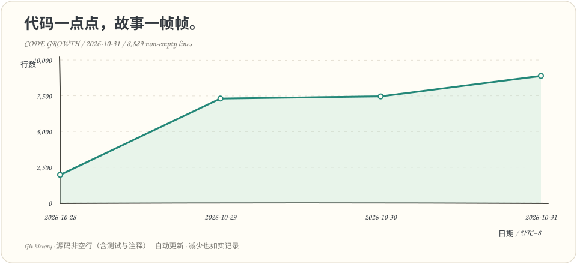

# Frame Studio / 视频制作 Agent 工作台

以 Codex 为制作中枢的本地 AI 视频工作台：从剧本、角色与物品素材，到片段生成、候选审阅、顺序连播和成片导出。前端使用原生 HTML/CSS/JS，Python + SQLite 保存项目、版本、任务与预算；FFmpeg/FFprobe 用于媒体处理和检查。

**新项目默认图片模型为 Seedream 5.0 Flash，视频供应商为 Seedance 2.5。** MiniMax H3 系列、Qwen Image3.0 和 Wan 系列保留可选。已有项目沿用自己的配置，升级代码不会自动切换供应商或重新生成历史素材。

## 快速开始

Python 3.9+；运行应用无需安装 pip 或 npm 依赖：

```sh
python3 server.py
# 或指定端口：
PORT=8766 python3 server.py
```

打开 [默认入口](http://127.0.0.1:8765) 或 [8766 入口](http://127.0.0.1:8766)。服务仅监听本机 loopback，适合单人使用，没有多用户认证，不应暴露公网。视频拼接、声音提取及倍速导出等功能需要另外安装 FFmpeg/FFprobe，二进制不随仓库分发。

首次使用先创建项目、填写剧本，再准备素材或视频片段。仓库中的《雾港来信》是演示策划，不代表已经生成媒体或产生成本。启动应用、保存配置和播放媒体不会自动提交模型生成。

## 页面与制作流程

| 页面 | 主要用途 |
| --- | --- |
| 制作总览 | 查看项目状态、预算占用与下一步入口 |
| 剧本 | 编辑故事、人物和项目内容 |
| 素材资产库 | 管理角色、物品、项目视觉风格、设计版本与已采用素材 |
| 视频制作 | 编辑片段、预览完整输入、生成与查询候选、审阅播放和导出 |
| 工具与设置 | 配置供应商、模型、密钥和项目预算；进入开发者诊断 |

**分镜工作台页面及 Tab 已删除。** 旧 `#shots` 地址转到视频制作；历史镜头、图片和审批记录仍保留。内部规则、机器提示、请求诊断、ComfyUI 配置与版本审计从“工具与设置 → 开发者诊断”进入。

推荐制作顺序：

1. **整理故事与素材设计。** Codex 按项目 Skill 准备剧本、角色、物品和风格；网页保存可读内容及版本。
2. **准备素材母版。** 预览必要视图和费用，生成独立候选，人工审阅采用；补角度须绑定明确母版。已有图片也可上传补充。
3. **编辑视频片段。** 填写完整 Prompt、时长、素材引用、声音参考、镜头语言与前置视频。素材参考直出视频路径不要求先生成分镜关键帧，也不会把素材图偷偷作为首帧。
4. **预览并确认本次输入。** 核对实际模型、完整 Prompt、引用版本与费用预占，再确认生成。修改内容、模型或引用后须重新确认；预算授权与内容确认分别校验。
5. **查询、审阅和交付。** 原任务返回后归档视频，保留候选及不可变输入快照；选择连播版本并人工验收。生成完成不等于质量通过。

项目选择持久化，项目间的剧本、素材、任务、检查、配置与预算隔离。历史镜头仍沿用图片与内容绑定的审批合同；素材参考视频使用独立的完整输入确认，不以旧镜头审批替代。

## 模型与接入范围

| 能力 | 已接入模型 / 路径 | 说明 |
| --- | --- | --- |
| 图片生成与参考编辑 | Seedream 5.0 Flash；Qwen Image3.0 标准版 / Pro | 用于角色、物品和图片候选；实际可用权限取决于账号 |
| 默认视频片段 | Seedance 2.5 | 素材参考、视频与声音参考；范围见 [方舟接入](docs/ARK_INTEGRATION.md) |
| MiniMax 视频片段 | H3 / H3 Highspeed / H3 Lite / H3 Max | 文本及素材参考生成、费用预览、异步提交与查询、本地归档 |
| 其他视频适配 | Wan3.0 / Wan3.0 Prime、Wan2.6 R2V Flash、Seedance 2.0 Mini | 保留原镜头 API 及对照路径；不表示片段编辑器已支持所有供应商 |
| 局部图片修复 | Seedream 编辑；可选本机 ComfyUI 模板 | 候选须人工采用，不保证框选区域外像素完全不变 |

当前素材参考片段生成接入 **Seedance 2.5 和 MiniMax**。其他视频适配的请求预检与任务入口仍在开发者诊断 / 旧镜头 CLI 中，能力不能互相套用。

### MiniMax 使用

1. 在“工具与设置”选择 **MiniMax**，选择模型、分辨率与画幅，保存配置。
2. 从 [MiniMax 中国站控制台](https://platform.minimax.cn/console/home) 获取 API Key，在当前供应商的密码框中安全保存；本地名称为 `MINIMAX_API_KEY`。
3. 在“视频制作”编辑片段，保存并预览完整输入、素材和费用。H3 支持 **768P / 2K、4–15 秒**；Highspeed / Lite 支持 **480P / 768P、4–15 秒**；Max 为 **480P / 768P、5–15 秒**。
4. 在项目预算表单中明确授权所选 MiniMax 模型使用相应预算，再确认本次输入并生成；已有暂停状态仍然生效。

H3 没有独立音频开关，本接入不发送 Seedance 的 `generate_audio` 参数。“使用声音参考”控制参考音频输入，不能承诺静音输出。参考图片最多9张；视频最多3段、合计15秒；音频最多3段、合计15秒；媒体合计最多12项。时长、分辨率和输入上限均按当前模型校验，不自动替换成别的规格。

费用展示区分公示原价预估、任务预占、用户提供的金额记录与已核实实付。MiniMax 按输出视频、输入视频和超出免费张数的图片计算预占，不能把预估当账单。详见 [MiniMax 接入与验证范围](docs/MINIMAX_VIDEO.md)。

**MiniMax 当前完成代码、Mock 和浏览器流程验证，尚未验证真实账户认证及模型出片效果。** 仓库代码和测试不包含真实账户密钥，不通过付费生成探测连接。

## 密钥、预算与任务记录

密钥由网页后端写入仓库外 `../.video-agent-studio-private/credentials.json`，目录权限0700、文件0600。网页不回显密钥，也不将其写入 SQLite、项目导出或 localStorage。可用 `STUDIO_SECRET_FILE=/absolute/private/folder/credentials.json` 指定其他仓库外路径。应用不从仓库内 `.env` 读取或保存密钥。

不同供应商使用自己的密钥：MiniMax 为 `MINIMAX_API_KEY`，方舟为 `ARK_API_KEY`，Wan3 为 `WAN3_API_KEY`；旧 Wan2.6 路径使用 `DASHSCOPE_API_KEY` 及业务空间配置。设置页区分“缺少密钥”“配置存在”和历史任务证据，存在密钥不等于当前认证成功。

- 没有全局付费解锁。图片与视频预算按项目、数据库和模型范围分别授权，不互相挪用；包含历史费用及未结算、在途预占。
- 暂停状态由项目记录决定。修改预算、密钥或模型不会解除暂停，也不会自动扩大已有模型授权。
- 提交前持久化请求意图与预占，获得供应商任务 ID 后按原编号查询。未知提交保留任务和预占，禁止自动重试；本地 UUID 不是供应商幂等保证。
- 自动查询有次数上限与错误退避，不会重新生成。历史输入、素材版本、审批与候选视频可追踪；保存草稿不改写旧任务快照。
- 未核实的实际费用保持未知。用户提供的账单或截图金额保留来源及匹配限制，不自动宣称结算完成。

运行数据位于 `data/studio.db`，媒体在本机素材目录。只发布源码、通用示例和文档；数据库、凭据、私人素材、成片及本地预览截图不发布。

## 视频播放与成片

视频制作页提供片段候选、实际输入记录、顺序连播、播放倍速及已生成成片的倍速下载。真实媒体缺失时显示空态，不使用假视频；后端媒体支持 Range/HEAD。本机导出不会提交新的模型生成任务。

也可使用 FFmpeg 拼接脚本：

```sh
python3 assemble.py assets/shot-01.mp4 assets/shot-02.mp4 -o episode-01.mp4
python3 assemble.py assets/shot-01.mp4 assets/shot-02.mp4 --subtitles assets/captions.srt -o episode-01-sub.mp4
```

先准备同编码、同规格、同音轨结构的已审阅片段。脚本不覆盖已有输出；复杂剪辑和混音仍需专门处理，当前没有网页时间线编辑器。

## 给 Codex 使用的 CLI

CLI 通过同一本机 HTTP 后端操作项目，输出 JSON，失败时返回非零退出码：

```sh
python3 cli.py projects list
python3 cli.py projects create '新故事'
python3 cli.py projects select 1
python3 cli.py script get
python3 cli.py script set --file /path/to/script.txt
python3 cli.py characters list
python3 cli.py shots list
python3 cli.py tasks preview SHOT_ID
python3 cli.py tasks status TASK_ID
python3 cli.py provider status
python3 cli.py budgets show
python3 cli.py audit tasks
python3 cli.py export
```

默认连接8766；可在子命令前加 `--url http://127.0.0.1:8765`。CLI 保留旧镜头、图片、任务及预算命令；**当前 `provider configure` / `secret` 命令尚未加入 MiniMax 选项，也没有完整片段编辑子命令**，MiniMax 配置与片段制作使用网页。具体参数用 `python3 cli.py --help` 及对应子命令帮助查询。

`shots approve` 仅供已有人类审阅证据的当前图片确认，不能由 Agent 自行代替用户；`--text-only` 不能代替图片质量批准。预算命令必须来自明确的人类金额和模型范围授权，不能把文档示例当作实际授权。

## 验证与资料

应用运行无需测试依赖；浏览器测试另需 Playwright Python 和 Chromium。

```sh
python3 -m unittest discover -s tests -p 'test_*.py'
node --check static/app.js
node --test tests/storyboard_checks.test.js
python3 scripts/check_secrets.py
# MiniMax 专项与隔离浏览器流程：
python3 -m unittest discover -s tests -p 'test_minimax.py'
python3 tests/browser_minimax.py
```

MiniMax 与页面删除这一版已通过261项 Python 回归、10项 JavaScript 测试、隔离 MiniMax 浏览器流程及本机只读页面验证。测试通过不等于每个供应商已经真实出片，实际授权、认证和效果须分别核验。旧分镜页面的浏览器脚本保留作历史参考，部分选择器仍需随页面删除更新，不作为当前导航验收命令。

- 接入：[MiniMax](docs/MINIMAX_VIDEO.md) · [方舟](docs/ARK_INTEGRATION.md) · [Wan3](docs/WAN3_INTEGRATION.md)
- 素材：[素材库](docs/MATERIAL_LIBRARY.md) · [设计与视图合同](docs/MATERIAL_RECIPES.md) · [图片修复](docs/SEEDREAM_EDIT_ADAPTER.md)
- 制作 Skill：[剧本](skills/frame-screenplay/SKILL.md) · [角色](skills/frame-character-assets/SKILL.md) · [物品](skills/frame-object-assets/SKILL.md) · [视觉风格](skills/frame-visual-style/SKILL.md) · [素材参考视频提示词](skills/frame-video-prompts/SKILL.md)
- 记录：[验证历史与限制](docs/VALIDATION.md) · [失败经验](docs/PRODUCTION_LESSONS.md) · [FFmpeg](docs/FFMPEG_SETUP.md)

其他文档保留各次迭代的时间与上下文，其中旧默认模型或页面描述不代表当前产品入口。

## 代码量增长



从 Git 历史回溯主分支每天最后一次提交的源码快照（北京时间），纵轴为**非空源码行数**，横轴为日期；包含测试与注释，代码删减也会如实下降。统计 `.py/.js/.ts/.tsx/.jsx/.html/.css/.sh`，排除文档、素材、依赖和运行数据；这不是剔除注释后的逻辑代码行数，也不代表质量或完成度。无提交日沿用前次状态。

每次推送到 `main` 后及每天北京时间 09:23 由 GitHub Actions 自动重建，也可在 Actions → **Update code growth** 手动运行。图表与[每日数据](docs/metrics/code-growth.json)随仓库保存，无需第三方服务或额外密钥。本地重建：`python3 scripts/code_growth.py`。

## 许可

仓库尚未选择许可证，当前不附加 LICENSE；公开可读不代表授予任意使用许可。
